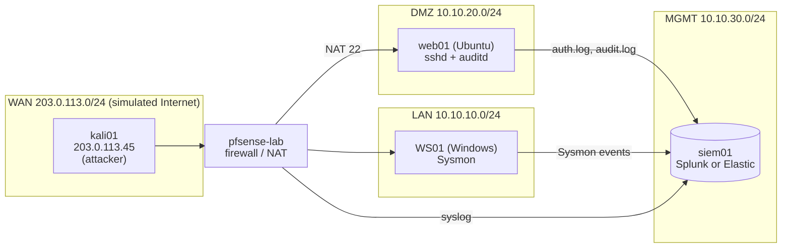
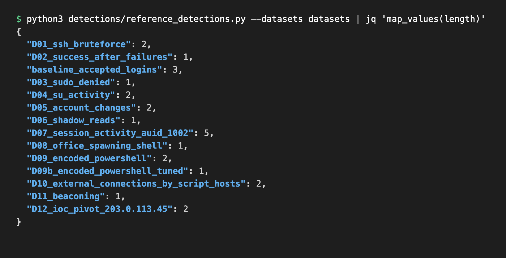
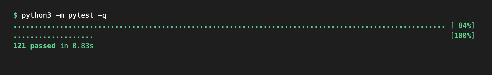

# SOC Detection & SIEM Lab

[](https://github.com/OYDeadpoolife/soc-siem-detection-lab/actions/workflows/ci.yml)

A reproducible SOC monitoring exercise built on **synthetic** Windows (Sysmon) and Linux (auth.log, auditd) security logs from one
fictional incident. It contains the datasets, **12 documented detections written in Splunk SPL**, Elastic (KQL, EQL, Query DSL)
equivalents for most of them, a SOC triage workflow, a full investigation walkthrough, alert examples and an incident report.
Every detection also has a plain-Python reference implementation that is tested against the data, so the detection *logic*
is verified even without a SIEM.

> **Read this first — what is verified and what is not.**
> * **Verified (executed, tests pass):** the dataset generator and the datasets; the Python reference detections; the structure
>   and safety of the query files; JSON and XML validity. See [TEST_RESULTS.md](TEST_RESULTS.md).
> * **NOT verified:** the SPL, KQL, EQL and Query DSL syntax and the field extractions **have not been run in Splunk or Elastic** (neither
>   was available when this was built). Every query file says `NOT TESTED`. The Elastic field names are approximations of the real
>   Filebeat/Winlogbeat output. Validate them in a real SIEM before relying on them.
> * **All data is synthetic.** It is not from a real organisation or incident, and no real attack was performed.

## In plain words

A SOC (security operations centre) is a team that watches logs from many computers to spot attacks. This project is a **practice
case**: a fictional company with made-up logs from a Linux web server and a Windows PC, and one made-up attack that crosses both.
It includes 12 *detections* (saved searches that flag suspicious activity) written for Splunk and Elastic, two common monitoring
products, a step-by-step investigation, and a Python version of every detection so the logic can be checked without those
products. The Splunk and Elastic queries themselves have not been run in the real products. New to these terms? See the
[glossary](docs/glossary.md).

## For a recruiter or SOC manager (30 seconds)

* **Problem:** a SOC analyst must turn raw logs into a decision: *is this an attack, how far did it go, what do we do next?*
* **What this shows:** detections for brute force, a successful login after it, privilege escalation, account persistence,
  credential-file access, Office-to-PowerShell execution, encoded commands and beaconing, each with MITRE ATT&CK mapping,
  false-positive notes and tuning ideas, plus a written investigation that follows one attacker across Linux and Windows.
* **What it shows about the author:** SIEM query writing (SPL, KQL, EQL), log normalization (raw → Splunk CIM → Elastic ECS),
  triage discipline, honest labelling of what is tested.
* **Where it fits:** step 2 of a four-project defensive workflow
  (network events → **SOC detection** → automated log analysis → DFIR investigation). It works on its own.

## Objectives

1. Document a SOC lab architecture and how its logs reach a SIEM.
2. Provide realistic synthetic Windows Sysmon (process creation, network connection, file creation) and Linux (auth.log, auditd) data.
3. Provide SPL detections and Elastic equivalents, with MITRE mapping and false-positive guidance.
4. Walk through an investigation of suspicious authentication and privilege activity, end to end.
5. Separate **tested logic** from **configuration that still needs a real SIEM**.

## Technologies

Splunk SPL, Elastic KQL / EQL / Query DSL, Sysmon, Linux auth.log and auditd, MITRE ATT&CK, Python 3 (generator, reference
detections, tests), pytest, Mermaid diagrams, GitHub Actions.

## Architecture



**How to read the diagram:** an attacker on the simulated Internet (left) reaches a firewall. Behind it are a Linux web server and a
Windows PC. Both computers, and the firewall, send their logs to one monitoring system (the SIEM, on the right), where the detections
look for the attack.

Details: [docs/architecture.md](docs/architecture.md). The firewall and its logs are covered by the pfSense lab project of this portfolio.

## What is in this repository

| Folder | Content | Status |
|---|---|---|
| `datasets/` | Synthetic logs: `linux/auth.log`, `linux/audit.log`, `linux/auth_ecs.jsonl`, `windows/sysmon_native.jsonl`, `windows/sysmon_ecs.jsonl` | Generated by `tools/generate_synthetic_logs.py`; reproducible; tested |
| `detections/` | Python reference implementation of every detection | Tested |
| `splunk/` | 13 SPL query files, `props.conf`/`inputs.conf`/`savedsearches.conf` examples, a dashboard | **NOT TESTED in Splunk** |
| `elastic/` | KQL table, 2 EQL sequences, 3 Query DSL bodies, Filebeat/Winlogbeat examples | **NOT TESTED in Elastic** |
| `alerts/` | Alert examples with analyst notes | Example documents |
| `docs/` | Architecture, setup, normalization, detections, triage workflow, investigation walkthrough, incident report, auditd rules | Documentation |
| `tools/`, `scripts/` | Dataset generator, bulk-file builder, Elasticsearch loader | Generator and bulk builder tested; loader `--dry-run` only |

## Quick start (no SIEM needed)

```bash
git clone https://github.com/OYDeadpoolife/soc-siem-detection-lab.git
cd soc-siem-detection-lab
python3 tools/generate_synthetic_logs.py --out-dir datasets      # re-creates the datasets (identical every time)
python3 detections/reference_detections.py --datasets datasets   # runs all 12 detections on them
```

The second command prints the findings as JSON. Expected highlights (real output):

```text
D02_success_after_failures : svc-backup logged in with a password from 203.0.113.45 at 10:06:41 after 59 failures
D05_account_changes        : support01 created at 10:11:20, added to group sudo at 10:11:50
D08_office_spawning_shell  : WINWORD.EXE started cmd.exe on WS01 at 11:30:14
D11_beaconing              : wscript.exe -> 203.0.113.45:443, 8 connections, average interval 59.2 s
```

To use the queries in a real SIEM, follow [docs/setup.md](docs/setup.md).

## The detections

| ID | Detection | Data source | MITRE ATT&CK | Elastic equivalent |
|---|---|---|---|---|
| DET-01 | SSH brute force | auth.log | T1110.001 | KQL, Query DSL |
| DET-02 | SSH success after many failures | auth.log | T1078.003 | KQL, EQL |
| DET-03 | sudo request denied | auth.log | T1548.003 | KQL |
| DET-04 | su activity | auth.log | T1078.003 | KQL |
| DET-05 | New account / privileged group change | auth.log | T1136.001, T1098 | KQL |
| DET-06 | Read of `/etc/shadow` | auditd | T1003.008 | not provided |
| DET-07 | Everything one login session did (`auid`) | auditd | T1078.003 | not provided |
| DET-08 | Office application starting a shell | Sysmon 1 | T1204.002, T1059 | KQL, EQL |
| DET-09 | Encoded PowerShell (untuned and tuned) | Sysmon 1 | T1059.001, T1027 | KQL, Query DSL |
| DET-10 | External connections by script hosts | Sysmon 3 | T1071.001, T1105 | KQL |
| DET-11 | Beaconing | Sysmon 3 | T1071.001 | not provided |
| DET-12 | Indicator pivot across sources | all | (investigation) | Query DSL |

Full descriptions, false positives, tuning and blind spots: [docs/detections.md](docs/detections.md).

## SOC triage and investigation

* [docs/triage-workflow.md](docs/triage-workflow.md) — how an alert is handled, as a flowchart and a checklist.
* [docs/investigation-walkthrough.md](docs/investigation-walkthrough.md) — the full investigation of the synthetic incident,
  query by query, with the expected results.
* [alerts/alert-examples.md](alerts/alert-examples.md) and [docs/incident-report-example.md](docs/incident-report-example.md).

## Screenshots

The images below are rendered from the real output of the commands shown, run on a clean clone of this repository. They are not
photographs of a terminal window, and nothing in them is edited. The commands are listed in [screenshots/README.md](screenshots/README.md).
**No Splunk or Elastic screenshot is included**, because the queries have not been run in those products.

**The Python reference detections** (the number is how many results each detection returns on the synthetic data):



**The test suite:**



<!--
After you run the queries in a real Splunk or Elastic, add:


-->

## Testing

```bash
python3 -m venv .venv && . .venv/bin/activate
pip install -r requirements-dev.txt
python3 -m pytest -v        # see TEST_RESULTS.md for what the tests do and do not prove
```

## Limitations

* **No SIEM was available**: SPL/KQL/EQL syntax, field extractions and dashboard are unverified (see above).
* The Elastic field names are *approximations* of Filebeat and Winlogbeat output; they differ between versions.
* Synthetic data is cleaner than real logs: no noise at real scale, no clock drift, no parsing problems.
* The detections are simple threshold and pattern rules. They can be evaded (slow brute force, renamed binaries, living-off-the-land
  tools) and can fire on legitimate activity; the false positives in the data are intentional.
* auditd and Sysmon need configuration on the monitored hosts; the examples here are starting points, not a hardened baseline.

## Future improvements

* Validate every query in Splunk Free/Enterprise and in an Elastic Stack lab, record the results and fix any syntax errors.
* Convert the detections to Sigma rules so they can be translated for several SIEMs.
* Add Windows authentication events (4624/4625) and firewall logs from the pfSense lab as additional sources.

## Status and verification

Test results here are real runs on the environment listed in [TEST_RESULTS.md](TEST_RESULTS.md); nothing marked NOT TESTED
has been run in a real SIEM.

## Author

**Orhay Yosef** — aspiring SOC / SIEM analyst. GitHub: [OYDeadpoolife](https://github.com/OYDeadpoolife)
· Repository: <https://github.com/OYDeadpoolife/soc-siem-detection-lab>
· License: [MIT](LICENSE)
