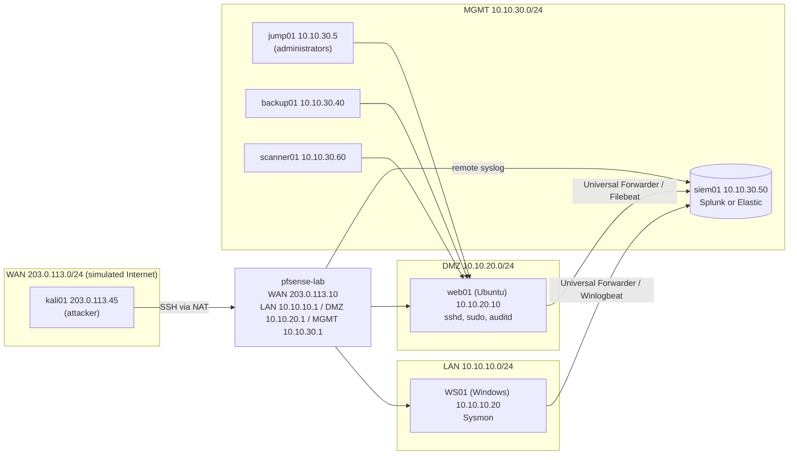
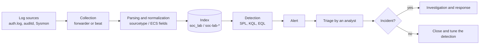

# Architecture

## The lab

This repository describes a small SOC lab and ships synthetic data as if that lab had produced it. **No virtual machine was built or
captured for this repository**; the data comes from the generator. The firewall part of the lab is built and documented in the pfSense
lab project.

## How data moves

| Stage | In this repository | Tested? |
|---|---|---|
| Log sources | `datasets/` (synthetic) | Yes (generator and format tests) |
| Collection | `splunk/inputs.conf.example`, `elastic/beats/*.example` | No (configuration examples) |
| Parsing / normalization | `splunk/props.conf.example`, `docs/log-normalization.md` | No for Splunk; the field mapping is documented |
| Detection | `splunk/spl/`, `elastic/` and `detections/` | Logic yes (Python); syntax no |
| Alert | `splunk/savedsearches.conf.example`, `alerts/alert-examples.md` | No |
| Triage / investigation | `docs/triage-workflow.md`, `docs/investigation-walkthrough.md` | Walkthrough numbers come from the Python reference |

## Log sources and what they can and cannot show

| Source | Shows | Does not show |
|---|---|---|
| `auth.log` | SSH logins (success and failure, method, source), sudo, su, account tools | What a root shell did afterwards; who ran `useradd` |
| auditd | Commands and file access with the original login `auid` | Anything not covered by a rule; needs tuning to avoid noise |
| Sysmon 1 | Process creation with command line and parent | Script content; activity before Sysmon started |
| Sysmon 3 | Network connections with process | Packet content; DNS names (needs Sysmon 22) |
| Sysmon 11 | File creation | File content |

## Design decisions

* **One scenario across all sources**, so a pivot (an IP address, an account) leads somewhere, as it would in a real investigation.
* **Deliberate false positives** (scanner, administrator typos, management agent, legitimate `visudo`) so tuning is visible.
* **Two field layouts for the same events** (Sysmon native for Splunk, ECS for Elastic) so normalization can be shown, not just described.
* **Python reference implementation** for every detection, so the logic is tested even without a SIEM.
