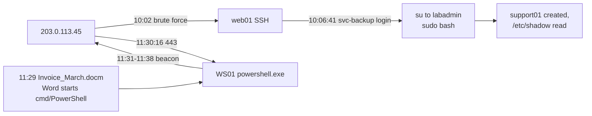

# Investigation walkthrough: suspicious authentication and privilege activity

This walkthrough follows the fictional incident in the datasets, as an analyst would, query by query.
**The expected results come from the Python reference implementation** (`python3 detections/reference_detections.py`) run on the
synthetic data. The SPL queries are the ones in `splunk/spl/` and are **NOT TESTED in Splunk**: if a real run differs from the
expected result, trust the raw data and fix the query.

All times are UTC, 2026-03-14. Data: index `soc_lab`, sourcetypes `linux_secure`, `linux_audit`, `sysmon:json`.

## Step 1 — The alert (DET-02)

**Alert:** "SSH login succeeded after many failures" for account `svc-backup` on `web01`, from `203.0.113.45`, at 10:06:41.

Query: `splunk/spl/DET-02_success_after_failures.spl`

| Field | Expected |
|---|---|
| time | 2026-03-14T10:06:41Z |
| user, src_ip, method | `svc-backup`, `203.0.113.45`, `password` |
| failures in the previous 10 minutes | 59 |

*First thought:* a service account logging in with a password from outside the network is unusual. Check the baseline before deciding.

## Step 2 — Baseline: how does `svc-backup` normally log in?

```spl
index=soc_lab sourcetype=linux_secure "Accepted" svc-backup
| rex "Accepted (?<method>password|publickey) for (?<user>\S+) from (?<src_ip>\S+) port"
| stats count BY user method src_ip
```

Expected: two rows for `svc-backup`: `publickey` from `10.10.30.40` (the backup server, 02:00) and `password` from `203.0.113.45`.

*Interpretation:* the normal login is a **key from an internal address**. The new login is a **password from the Internet**. It does not fit the
account's behaviour. This is a strong indicator, but still not proof.

## Step 3 — Scope the source address (DET-01 and DET-12)

DET-01 shows the burst: `203.0.113.45`, 49 failures in the 10:00 bucket and 10 in the 10:05 bucket (one burst split by the fixed bins),
about 56 attempts against 12 user names between 10:02 and 10:05 (see the Python reference for the exact numbers).
The lab scanner `10.10.30.60` (7 failures) is **not** reported at the threshold of 10: that is the tuning at work.

DET-12 pivots on the address:

| Source | Matches |
|---|---|
| `linux_secure` | 214 lines |
| `sysmon:json` | 9 events (on WS01!) |

*Interpretation:* the same address also appears in the Windows data. That makes this bigger than one SSH server; note it and continue,
we will come back to it (step 8).

## Step 4 — What did the account do next? (DET-03, DET-04)

DET-03 (`sudo` denied): `svc-backup`, "user NOT in sudoers", 10:08:05. The service account tried to become root and was refused.

DET-04 (`su`):

| Time | From | To | Outcome |
|---|---|---|---|
| 10:08:40 | `svc-backup` | `labadmin` | failure |
| 10:09:30 | `svc-backup` | `labadmin` | success |

*Interpretation:* after the sudo refusal, the attacker tried `su` to an administrator account — failed once, then succeeded
(probably a reused password). The attacker is now `labadmin` (MITRE T1078.003).

## Step 5 — Persistence and credential access (DET-05, DET-06, DET-07)

DET-05: `support01` was **created** at 10:11:20 and **added to group `sudo`** at 10:11:50. A new privileged account is classic persistence
(T1136.001, T1098).

`auth.log` does not say *who* ran `useradd`. auditd does — with the **original login user** (`auid`):

DET-07 with `auid="1002"` (the uid of `svc-backup`) returns five records:

| Time | Record | Effective uid | Program |
|---|---|---|---|
| 10:10:02 | USER_CMD | 1000 (labadmin) | `/usr/bin/sudo` |
| 10:11:20 | SYSCALL | 0 | `/usr/sbin/useradd` |
| 10:11:20 | ADD_USER | 0 | `/usr/sbin/useradd` |
| 10:11:50 | SYSCALL | 0 | `/usr/sbin/usermod` |
| 10:12:44 | SYSCALL | 0 | `/usr/bin/cat` |

*Interpretation:* although the commands ran as `labadmin` and then as root, **the login session is the one `svc-backup` opened at 10:06:41**.
That is how auditd ties the root actions back to the compromised service account.

DET-06 adds the last record: `/usr/bin/cat` read `/etc/shadow` at 10:12:44 (`auid=1002`, `uid=0`): credential access (T1003.008). The three
`unix_chkpwd` reads at 08:30 are normal PAM behaviour and are excluded by the query.

## Step 6 — Verdict for `web01` and containment

* **Verdict: true positive, high severity.** Brute-force success, privilege escalation through `su` and `sudo`, a new privileged
  account, and a read of the password hash file.
* **Recommended actions (for the incident owner):** isolate `web01`, disable `support01`, reset `svc-backup`, `labadmin` and any
  account whose hashes may have been read; block `203.0.113.45`; preserve evidence first (memory and disk) and hand over to DFIR.

## Step 7 — The Windows side (DET-08, DET-09, DET-10, DET-11)

| Detection | Result |
|---|---|
| DET-08 | 11:30:14 — `WINWORD.EXE` starts `cmd.exe` on WS01, user `HARBOR\jdoe` |
| DET-09a | 2 hits: the agent at 09:00:30 and the attack at 11:30:14 |
| DET-09b | 1 hit (11:30:14): the inventory agent is excluded |
| DET-10 | `powershell.exe` and `wscript.exe` connecting to `203.0.113.45:443` (1 and 8 connections) |
| DET-11 | `wscript.exe` beaconing: 8 connections, average 59.2 s, standard deviation 0.52 s |

*Interpretation:* a document opened in Word starts a hidden, encoded PowerShell command, which contacts the same address (`203.0.113.45`) and
then a script host calls home about once a minute. The encoded command in this data decodes to harmless text; in a real case you would
decode it (`echo <base64> | base64 -d | iconv -f UTF-16LE -t UTF-8`) and treat it as hostile.

## Step 8 — Connect the two halves

The address `203.0.113.45` links an SSH attack on `web01` (10:02–10:12) to a document-based execution on WS01 (11:29–11:38). That supports
one incident with a single actor *using the same infrastructure* — **an inference, not proof**: a shared address can also be a shared proxy.



## Step 9 — Hand-over and lessons

* **Hand over to DFIR:** evidence list (WS01 triage package, `web01` auth.log and auditd), hashes, timeline, indicators
  (`203.0.113.45`, `http://203.0.113.45/stage2`, `harbor_update.js`, `support01`). The DFIR toolkit project continues from here.
* **Detection lessons:** (1) the brute-force detection should use a sliding window; (2) a service account logging in with a
  password should alert by itself; (3) the inventory agent needs a permanent exclusion on its full path; (4) the host that
  receives a successful brute-force login should be isolated automatically in a real SOAR setup.
