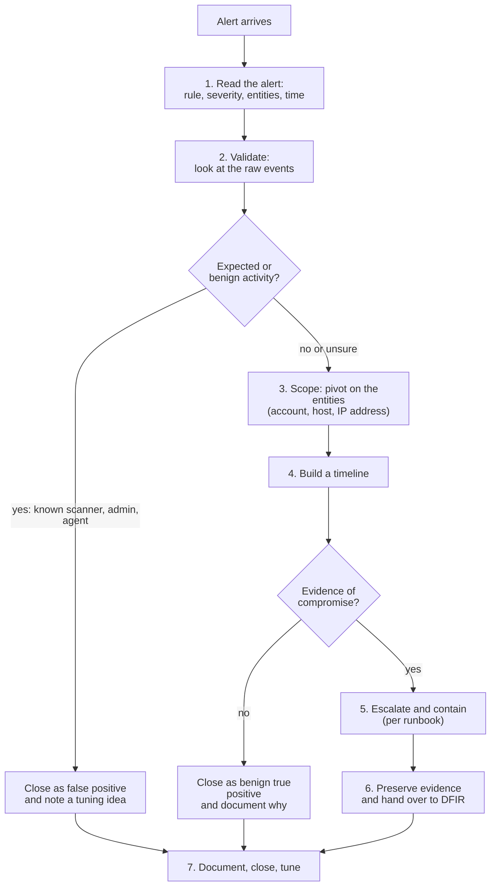

# SOC triage workflow

A junior analyst's routine for an alert. Adjust the details to your organisation's runbooks and ticketing system.



## Checklist

1. **Read the alert.** Which rule? What severity? Which account, host and address? What time range?
2. **Validate with raw events.** Open the events behind the alert. Did it really happen as described? Do the fields look right
   (a parsing mistake can create a false alert)?
3. **Check for the expected.** Is the source a known scanner, jump host or management agent? Is the account a service account
   that normally logs in differently (the baseline)? Is there a change ticket?
4. **Scope by pivoting.**
   * By *address*: where else does it appear (firewall, other servers, workstations)? (DET-12)
   * By *account*: what did it do before and after? (DET-04, DET-03, DET-07)
   * By *host*: what else happened on it around the same time?
5. **Build a timeline** in UTC, marking what you *observed* and what you *infer*.
6. **Decide.** True positive (malicious), benign true positive (real event, legitimate cause), false positive (rule or data problem).
   Write the reasoning, not only the verdict.
7. **Escalate and contain** according to the runbook: isolate the host, disable the account, block the address. Containment is a
   decision for the incident owner; a junior analyst escalates with the evidence they have.
8. **Preserve evidence.** Do not clean up. Note what could be volatile (memory, running processes). Hand over to DFIR with hashes
   and a list of sources (see the DFIR toolkit project).
9. **Close and improve.** Record what would have made this faster, and tune the detection.

## Severity guide (example)

| Severity | Example in this lab | Typical first response |
|---|---|---|
| Low | Username enumeration alone | Review at the end of the shift; block the source if repeated |
| Medium | Brute force with no success; sudo denied | Validate within the hour; check for a later success |
| High | Success after brute force (DET-02); Office starting a shell (DET-08) | Validate immediately; page the on-call analyst |
| Critical | High detections chained: the account then escalated, created a new account and the same address appears on another host | Declare an incident; contain; engage DFIR |

## Triage notes template

```text
Alert:            <rule name and ID>        Time (UTC): <...>
Entities:         <account> / <host> / <address>
What I saw:       <raw events, with times>
Baseline:         <what is normal for this account/host>
Benign cause?:    <yes/no and why>
Pivots:           <queries run and results>
Timeline:         <...>
Verdict:          <true positive / benign true positive / false positive>
Actions:          <escalated to ..., contained ..., ticket ...>
Tuning idea:      <...>
```
